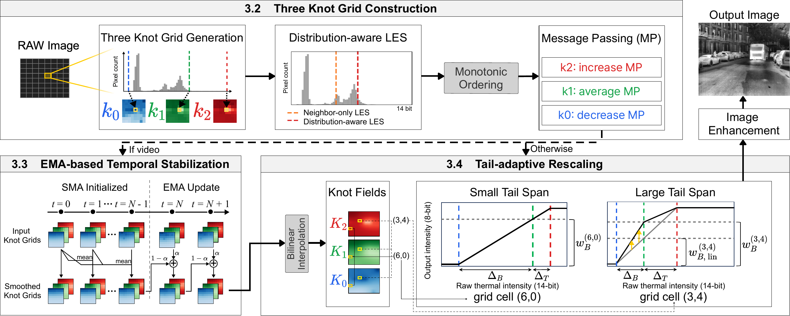
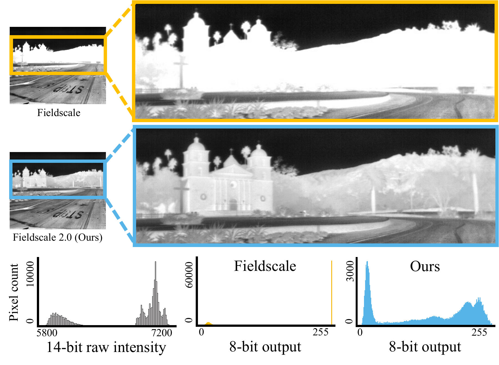
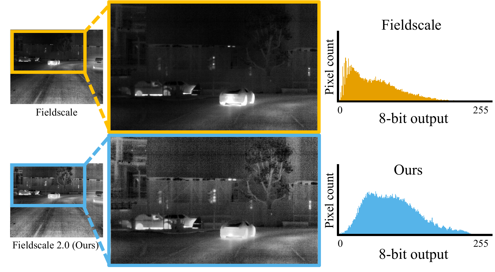

<div align="center">
<h1>Fieldscale 2.0</h1>
<p><strong>Spatiotemporal Tail-adaptive Rescaling for Thermal Infrared Images</strong></p>

**Eunseo Kim** · Hyeonjae Gil · Tai Hyoung Rhee · Ayoung Kim · Dongjae Lee<sup>*</sup>

Department of Mechanical Engineering, Seoul National University<br/>
**ICCAS 2026** · <sup>*</sup>Corresponding author

[Quick start](#quick-start) · [Usage guide](docs/USAGE.md) · [Citation](#citation)
</div>

**Fieldscale 2.0** turns high-bit-depth thermal images and video into 8-bit images while preserving scene details. It combines spatial adaptation, tail-adaptive rescaling, and temporal stabilization to address saturation, residual darkening, and flickering.

<div align="center">
<a href="assets/pdf/overview.pdf"></a>
</div>

The examples below show two improvements over the original Fieldscale: **building details remain visible in saturated regions**, and **backgrounds stay clearer around hot objects**. For video, smoothing the spatial fields helps reduce frame-to-frame flickering.

<div align="center">
<a href="assets/pdf/saturation.pdf"></a>
<a href="assets/pdf/darkening.pdf"></a>
</div>

<p align="center"><sub>Original paper examples: saturation on FLIR ADAS v1 and residual darkening on FLIR ADAS v2. Click any figure for its full-resolution PDF.</sub></p>

## Quick start

Requires **Python 3.10+**, NumPy, and OpenCV.

```bash
git clone https://github.com/rladmstj/fieldscale2.git
cd fieldscale2
python -m venv .venv
source .venv/bin/activate
python -m pip install -r requirements.txt
```

Rescale single-channel raw thermal frames, typically `uint16` TIFF or PNG files:

```bash
python -m fieldscale2 \
  --input-dir /path/to/raw_frames \
  --output-dir outputs/demo \
  --workers 1
```

Outputs include the rescaled images, `manifest.csv`, and `summary.json`. See the [usage guide](docs/USAGE.md) for video processing and diagnostic outputs, or run `python -m fieldscale2 --help` for all options.

## Citation

```bibtex
@misc{kim2026fieldscale2,
  title={Fieldscale 2.0: Spatiotemporal Tail-adaptive Rescaling for Thermal Infrared Images},
  author={Kim, Eunseo and Gil, Hyeonjae and Rhee, Tai Hyoung and Kim, Ayoung and Lee, Dongjae},
  year={2026},
  note={ICCAS 2026},
  url={https://github.com/rladmstj/fieldscale2}
}
```

## Acknowledgments and License

This work builds on **Fieldscale**, the locality-aware thermal image rescaling method by Hyeonjae Gil, Myung-Hwan Jeon, and Ayoung Kim (RA-L 2024 / ICRA 2025). Fieldscale 2.0 extends its field-based approach with tail-adaptive rescaling and updated temporal smoothing.

For the original Fieldscale paper, supplementary video, and Python/C++ implementations, visit the [original Fieldscale repository](https://github.com/HyeonJaeGil/fieldscale).

This code is released under the [MIT License](LICENSE), with the original copyright notice retained.
